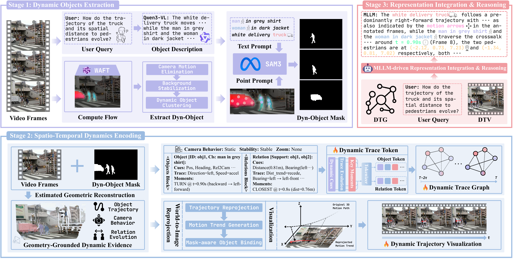

<div align="center">


# DynTrace: Tracking Dynamic Object Evidence for 4D Spatio-Temporal Reasoning in MLLMs

Rongxin Gao<sup>1,†</sup>, Yuzhi Huang<sup>3,†,♣</sup>, Dongxuan Liu<sup>1,†</sup>, Chu Li<sup>2</sup>, Zhenye Wang<sup>2</sup>, Jie Wu<sup>3</sup>, <br>
Shuzhao Xie<sup>3</sup>, Jingyan Jiang<sup>4,*</sup>, Xinghao Ding<sup>1</sup>, Xiaotong Tu<sup>1,*</sup>, Yue Huang<sup>1</sup>

<sup>1</sup>Xiamen University &nbsp;&nbsp;&nbsp;&nbsp; <sup>2</sup>China University of Mining and Technology <br>
<sup>3</sup>Shenzhen International Graduate School, Tsinghua University &nbsp;&nbsp;&nbsp;&nbsp; <sup>4</sup>Shenzhen Technology University

<sup>†</sup>Equal contribution. &nbsp;&nbsp;&nbsp;&nbsp; <sup>♣</sup>Project leader. &nbsp;&nbsp;&nbsp;&nbsp; <sup>*</sup>Corresponding authors.

[](https://dyntrace.github.io/) &nbsp;&nbsp;&nbsp;&nbsp; [](https://arxiv.org/abs/2607.12503)

</div>


This repository is the official implementation of **DynTrace: Tracking Dynamic Object Evidence for 4D Spatio-Temporal Reasoning in MLLMs** (ACM MM 2026).

## Method Overview

<div align="center">
  
  <p><em>Figure: Overall pipeline of DynTrace, featuring Stage 1 (Dynamic Objects Extraction), Stage 2 (Spatio-Temporal Dynamics Encoding), and Stage 3 (Representation Integration & Reasoning).</em></p>
</div>

## TODO

- [ ] Release inference code
- [ ] Release evaluation code

## BibTeX

```bibtex
@inproceedings{gao2026dyntrace,
  title={DynTrace: Tracking Dynamic Object Evidence for 4D Spatio-Temporal Reasoning in MLLMs},
  author={Gao, Rongxin and Huang, Yuzhi and Liu, Dongxuan and Li, Chu Ext and Wang, Zhenye and Wu, Jie and Xie, Shuzhao and Jiang, Jingyan and Ding, Xinghao and Tu, Xiaotong and Huang, Yue},
  booktitle={Proceedings of the ACM International Conference on Multimedia (ACM MM)},
  year={2026},
  note={Accepted. arXiv preprint arXiv:2607.12503}
}